<p align="center">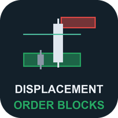</p>

# Displacement Order Blocks (MetaTrader 5 and MetaTrader 4)

A free indicator that draws **demand and supply zones left by a strong candle that closes through the newest swing**, and
follows each zone through three states: fresh, tested and broken. Everything is decided on closed bars, so a zone never
appears, moves or disappears after its bar has closed. Source for both editions, a Python reference of the rules, and the
tests that were used to check that the MT5 and MT4 code, the Python reference and each other all agree.

**Website:** [allanninal.dev/mql5 (indicators)](https://www.allanninal.dev/mql5/#indicators) · [MT4 editions](https://www.allanninal.dev/mql5/#mt4) · [allanninal.dev](https://www.allanninal.dev)
· **Contact:** message me on [LinkedIn](https://www.linkedin.com/in/allanninal/).

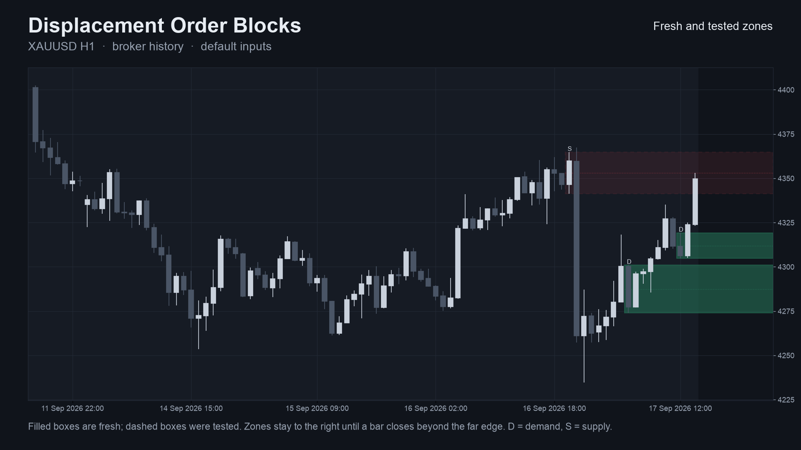

> It is an indicator, not a strategy. It draws zones and sends alerts, and places no trades. **The zones describe what
> price did on past bars; they are not predictive.** A test against randomly placed levels, with the numbers, is in
> [Do the zones predict anything?](#do-the-zones-predict-anything-no-measurably).

## Get it on the MQL5 Market

| Edition | Platform | Price | Link |
|---|---|---|---|
| Displacement Order Blocks | MT5 | free | coming soon on the MQL5 Market |
| Displacement Order Blocks MT4 | MT4 | free | coming soon on the MQL5 Market |
| Displacement Order Block Scanner MT5 | MT5 | paid | coming soon on the MQL5 Market |
| Displacement Order Block Scanner MT4 | MT4 | paid | coming soon on the MQL5 Market |

The Market builds will be the same calculation as the source in this repository. The two scanner editions are a separate,
paid product that is **not** part of this repository (see [Free vs Pro](#free-vs-pro)). Links will be added here when the
listings are live.

## Contents

1. [What it is and who it is for](#what-it-is-and-who-it-is-for)
2. [Why it was built](#why-it-was-built)
3. [How it works](#how-it-works)
4. [Do the zones predict anything? No, measurably](#do-the-zones-predict-anything-no-measurably)
5. [Non-repainting and the tests](#non-repainting-and-the-tests)
6. [Architecture and buffers](#architecture-and-buffers)
7. [Inputs, alerts, install and compile](#inputs-alerts-install-and-compile)
8. [Run the Python reference and the tests](#run-the-python-reference-and-the-tests)
9. [Honest limits](#honest-limits)
10. [Free vs Pro](#free-vs-pro)
11. [Licence](#licence)

## What it is and who it is for

**What:** a zone is made when a candle (the *displacement candle*) closes beyond the newest swing high or low, with a range
of at least `1.0 x ATR` and a body of at least `55 %` of its range. The zone is the nearest candle of the other colour
before it (its whole range, its body, or its body plus the far wick). The zone is drawn to the right until price breaks
it. It is **fresh** until a wick comes back to it, **tested** after that (every later re-entry is counted, shown as `D x2`,
`S x3`) and **broken** once a bar closes (or wicks, your choice) beyond its far edge. Alerts for a new zone, a first test
and a broken zone, by pop-up, sound, push notification and e-mail.

**For:** traders who mark order blocks or supply and demand zones by hand and want the same objects drawn by fixed,
written-out rules, so that the chart can be reproduced and checked. Also for developers who want a small, tested zone
engine with documented buffers to read from an EA with `iCustom`.

**Not for:** anyone who expects a zone to predict a reaction. See the measured result below.

| | |
|---|---|
| 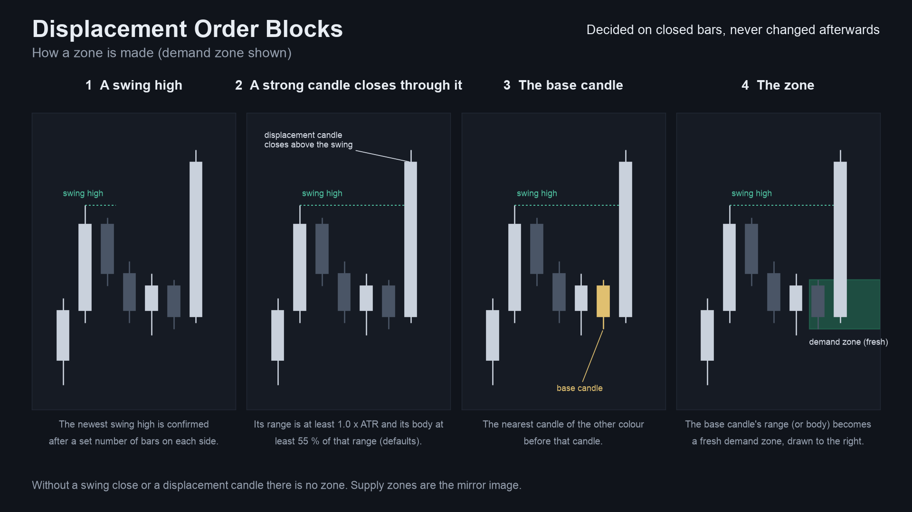 | 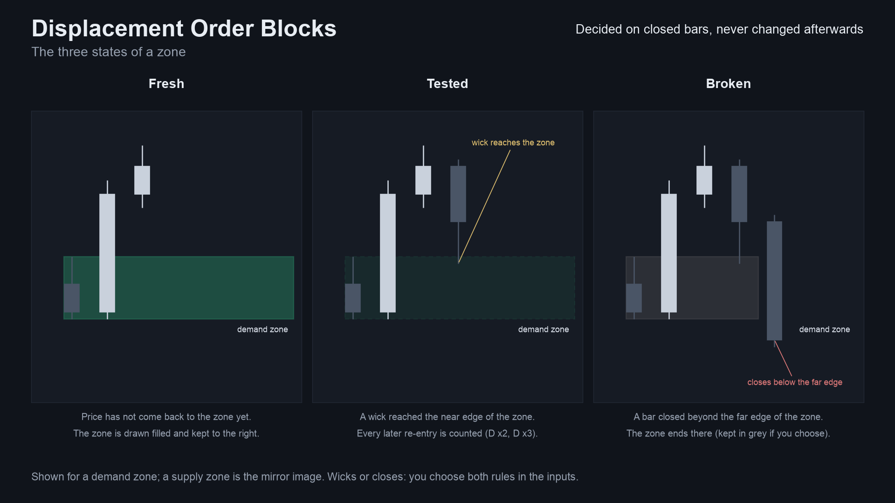 |
| 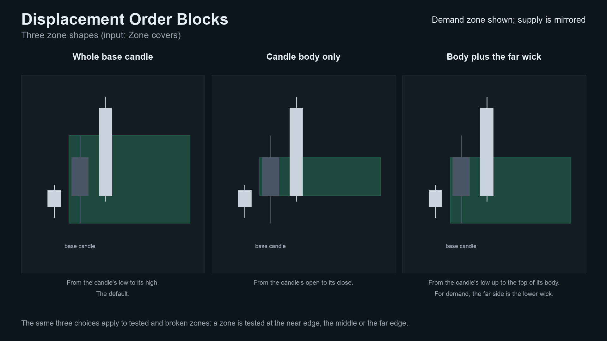 | 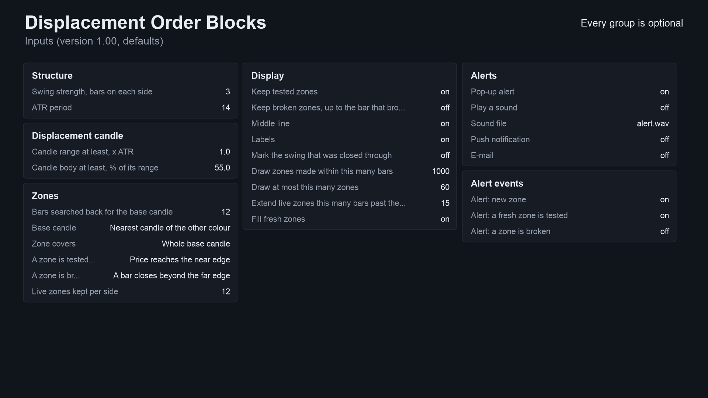 |

Image notes: the chart on 01 and 02 is drawn by the Python reference on broker history (the same zones the indicator
draws); the other images are schematic cards. They are illustrations, not terminal captures. MT4 versions are in
[`docs/images/mt4/`](docs/images/mt4).

## Why it was built

Order blocks are everywhere in retail trading content, and traders ask for tools that mark them. The reasons for building
this one, with the evidence we actually have:

- **A readable, written-out rule set.** "Order block" means different things in different tools. Here every step of the
  detection is a formula you can read and test (below).
- **Demand exists, but it is crowded.** A scan of 2,014 MQL5 Freelance jobs (2025-11 to 2026-10, keyword
  classification, accurate to roughly plus or minus 15 %) found 116 jobs in the SMC / ICT / order block / FVG / liquidity
  group and 26 that mention an order block. The MQL5 Market already has many order-block and market-structure indicators,
  so this is not a gap in the market. It is one more careful implementation with tests.
- **Trust in what is drawn.** In the same freelance scan, 29 jobs list "non-repainting" as an explicit requirement, so the
  design rule is that nothing on the chart changes after its bar has closed.
- **Honesty about value.** We tested whether these zones react better than levels placed at random (below). They do not,
  by a margin that is not meaningful. So this is a drawing and bookkeeping tool, and it says so.

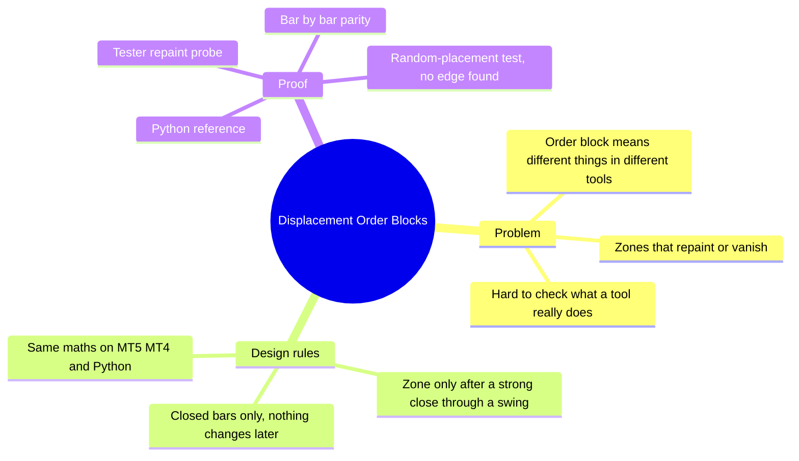

## How it works

### The rules, step by step

Let `O, H, L, C` be a bar's open, high, low, close, `i` the bar index (oldest = 0), `d = +1` for demand (bullish) and
`d = -1` for supply (bearish). Defaults in brackets.

1. **ATR** (Wilder's smoothing, seeded with the simple average of the first `n` true ranges, `n` = 14):
   `TR[i] = max(H-L, |H-C[i-1]|, |L-C[i-1]|)`, `ATR[i] = (ATR[i-1] * (n-1) + TR[i]) / n`. The test on bar `i` uses the ATR
   as it was **before** the bar, `ATR[i-1]`.
2. **Swing** (`swing` = 3): bar `p` is a swing high when the `swing` bars on its left have strictly lower highs and the
   `swing` bars on its right have highs not above it (mirror image for a low). It is known `swing` bars later. A new swing
   replaces the previous swing of its side.
3. **Break:** the first bar whose close is beyond the newest swing high (demand) or low (supply). That swing is then used
   up, whether or not a zone is made.
4. **Displacement candle:** the breaking bar must have `H-L >= 1.0 x ATR[i-1]`, a body `|C-O| >= 55 %` of its range, and
   close in the break's direction (`(C-O) * d > 0`). A body of exactly 55 % counts: decimal prices can leave the last bit
   off, so a tolerance of `1e-9 x range` is applied identically in MQL5, MQL4 and Python.
5. **Base candle** among the `search` bars before the break bar (`search` = 12):
   - mode "Nearest candle of the other colour" (default): the nearest bar going back with `(C-O) * d < 0`;
   - mode "Other-colour candle where the move began": find where the move started inside those bars (demand: the lowest
     low, supply: the highest high, the latest bar on a tie), then take the nearest other-colour candle at or before it,
     still inside the window.

   No such candle means no zone.
6. **Zone:** `top` and `bot` of the base candle, as the whole candle (high to low), the body only, or the body plus the
   far-side wick (demand: low to body top, supply: body bottom to high). The zone exists from the bar after the break.
7. **States**, checked on each later closed bar, **broken first** (a bar that does both only breaks the zone):
   - **tested:** a wick reaches the near edge (default), the middle, or the far edge, from the bar after the zone was made;
   - **retest:** after a bar that was outside, a later wick enters again; each re-entry is counted;
   - **broken:** a close (default) or a wick beyond the far edge.
8. **Limit** (`max live` = 12): at most 12 live zones per side. When a new one is made, the oldest live zone of that side
   is dropped.

### Per-bar algorithm

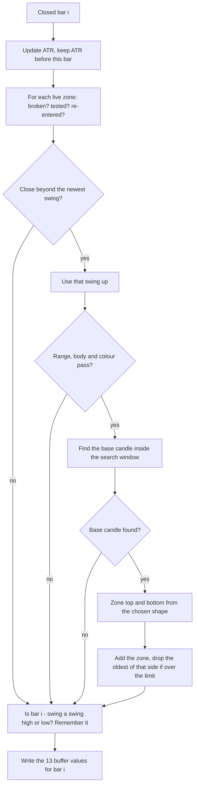

### Zone states

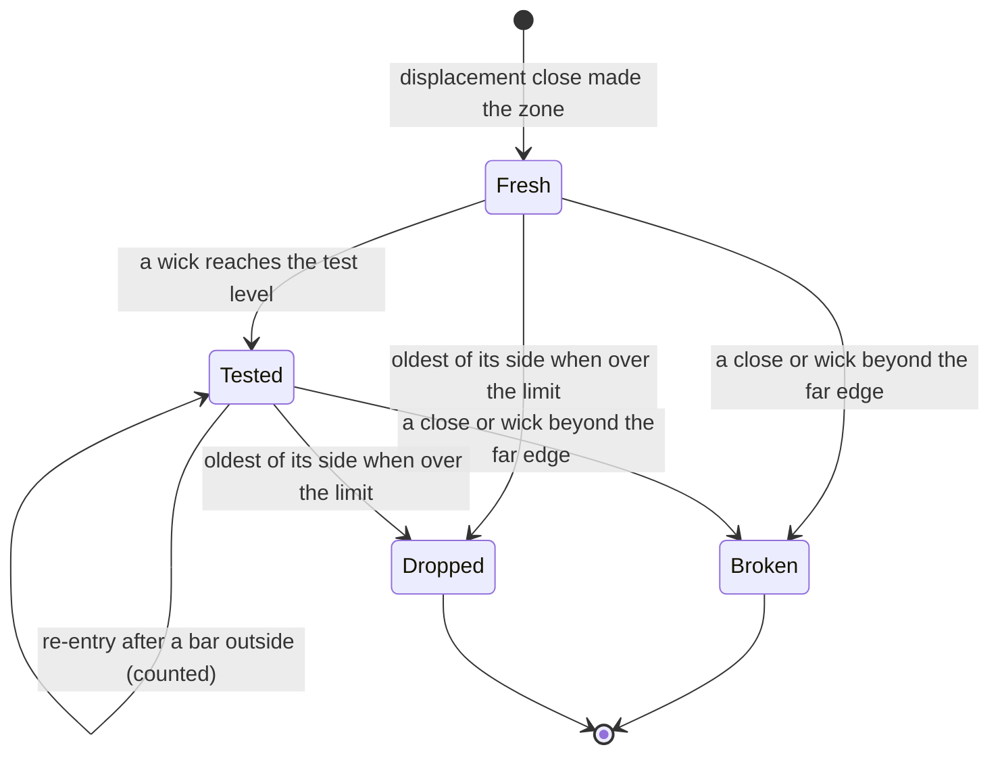

### Alert flow

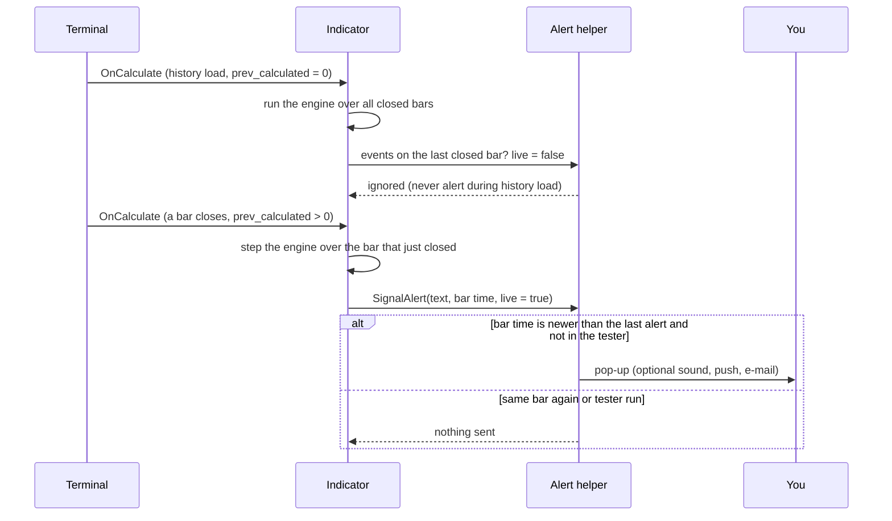

### How often it makes zones (measured)

Zones made per month by the Python reference with the default inputs on closed bars of broker history, 2023-10-02 to
2026-10-12 (36 months). Source: [`docs/data/zones-per-month.json`](docs/data/zones-per-month.json). This counts zones only.
It says nothing about profit.

```mermaid
xychart-beta
    title "Zones made per month by timeframe (EURUSD and XAUUSD, defaults)"
    x-axis ["M15", "H1", "H4", "D1"]
    y-axis "zones per month" 0 --> 90
    bar [81.8, 21.3, 6.6, 1.0]
    bar [77.7, 20.1, 6.2, 1.0]
```

First series EURUSD, second XAUUSD.


## Do the zones predict anything? No, measurably

Before publishing, the zones were tested against levels placed at random. The question: after price first comes back to a
zone, does it move away from the zone more often than it would from a level of the same size and distance that is not a
zone? The result is that the difference from random placement is not meaningful. These tables are part of the README on
purpose: do not read the zones as support and resistance that is likely to hold.

**Method (descriptive study, not a trading test).**

- **Data:** broker M1 history resampled to H1 and H4, 2015-01 to 2026-10, eight symbols (EURUSD, GBPUSD, USDJPY, AUDUSD,
  GBPJPY, XAUUSD, XAGUSD, BTCUSD), so 16 symbol and timeframe cells. Bid bars; no spread, no costs.
- **Zones:** the Python reference with the default inputs, except no zone limit so every zone is followed (31,823 zones with
  the default base candle, 26,192 with the "where the move began" base candle).
- **Outcome:** after the first test, price either moves `1.0 x ATR` (the ATR before the displacement candle) away from the
  zone in its direction before a bar closes through the far edge ("held"), or the close comes first ("failed"). Neither
  within 50 bars counts as open. Held rate = held / (held + failed).
- **Control:** each real zone is copied with the same creation bar, direction, height and ATR, but its near edge is moved to
  the distance from the creation bar's close of another real zone of the same direction, picked by a random shuffle. The
  same state rules run on it. 500 shuffles give the held rate that a level of that size and distance would get anyway.
- **Split:** zones made 2015-2020 (train) and 2021-2026 (holdout). Nothing is fitted; the split only shows whether an effect
  repeats.
- **Check:** the simulator's outcome for every real zone was asserted equal to the engine's.

**Result.** Source: [`research/results/zone_stats.csv`](research/results/zone_stats.csv) (default base) and
[`research/results/zone_stats_move.csv`](research/results/zone_stats_move.csv) (move-began base), 16 cells each.

| Base candle | Period | Cells where real > random | Mean held-rate difference | Cells with p < 0.05 (chance: about 0.8 of 16) |
|---|---|---|---|---|
| Nearest other colour (default) | train 2015-2020 | 10 / 16 | +0.8 points | 2 / 16 |
| Nearest other colour (default) | holdout 2021-2026 | 9 / 16 | +0.2 points | 1 / 16 |
| Where the move began | train 2015-2020 | 11 / 16 | +1.1 points | 4 / 16 |
| Where the move began | holdout 2021-2026 | 13 / 16 | +1.2 points | 4 / 16 |

With the default base candle the real zones "hold" about 57 % of the time and the random levels about 56 %. Nearly all of
that rate is geometry (a level of ATR size just below price), not the zone, and the small 2015-2020 effect did not repeat in
2021-2026. The "where the move began" mode shows a difference of about one percentage point that appeared in both halves,
which is the one result worth a second look. About one point on a hold rate, measured on bid bars before spread, across 16
cells and two modes tried, is not an edge.

Held rate minus random-placement rate, in percentage points, over all years, per cell (default base candle). Cell numbers:
1 EURUSD H1, 2 EURUSD H4, 3 GBPUSD H1, 4 GBPUSD H4, 5 USDJPY H1, 6 USDJPY H4, 7 AUDUSD H1, 8 AUDUSD H4, 9 GBPJPY H1,
10 GBPJPY H4, 11 XAUUSD H1, 12 XAUUSD H4, 13 XAGUSD H1, 14 XAGUSD H4, 15 BTCUSD H1, 16 BTCUSD H4.

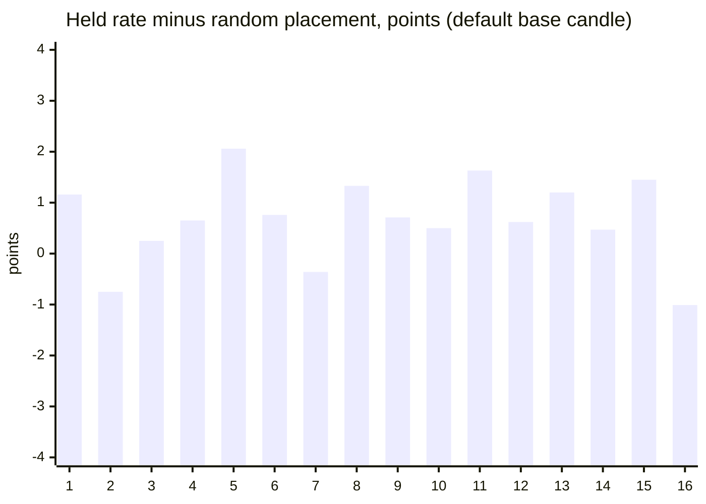

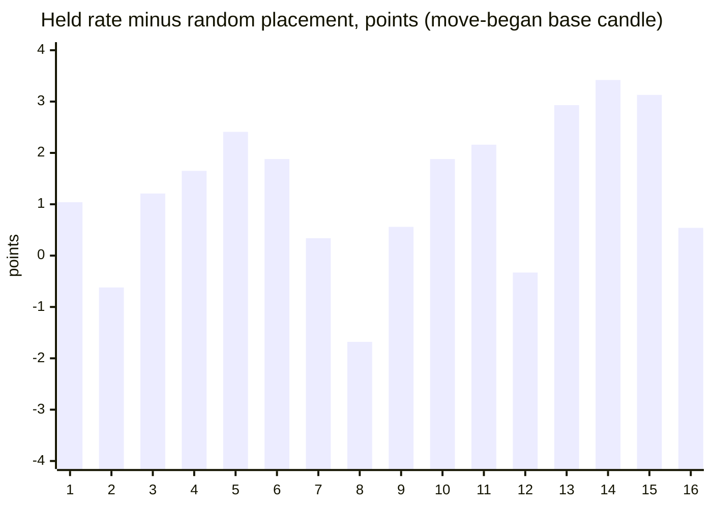

The analysis script is not part of this repository; its per-cell output is. The per-cell differences are small, and they
are in both directions.

## Non-repainting and the tests

"Non-repainting" is easy to claim. Here is what was actually run. Raw result files are in [`tests/results/`](tests/results).

**1. Three implementations, compared bar by bar.** The Python reference
([`tests/reference.py`](tests/reference.py)) is an independent re-implementation of the rules above. The MT5 and MT4
indicators were dumped bar by bar (all 13 buffers) in the MetaTrader test environment, and
[`tests/check_parity.py`](tests/check_parity.py) compared each dump with the reference. Pass means: on every closed bar
every buffer is equal (prices within 1e-9 relative, counts exactly, empty where the reference has nothing).

| | MT5 | MT4 |
|---|---|---|
| dumps compared | 48 (4 input sets x 4 symbols x M15/H1/H4) | 49 (same 48 + one every-tick EURUSD H1) |
| bars compared | 2,022,888 | 1,022,441 |
| zones compared | 71,611 | 33,030 |
| breaks of a swing compared | 145,245 | 73,420 |
| result | ALL PASS, 0 differences | ALL PASS, 0 differences |

Symbols: EURUSD, GBPJPY, XAUUSD, BTCUSD. Input sets: defaults; swing 5 / body zone / middle test / wick break / no limit;
swing 2 / ATR 10 / range 1.5 x ATR / body 60 % / search 5 / mixed zone / far-edge test / limit 3; the
"where the move began" base. Source: [`tests/results/parity-mt5-and-mt4.txt`](tests/results/parity-mt5-and-mt4.txt). The
MT5 M15 files are short (about 3,500 bars each); the MT4 M15 files are longer (up to about 44,000 bars).

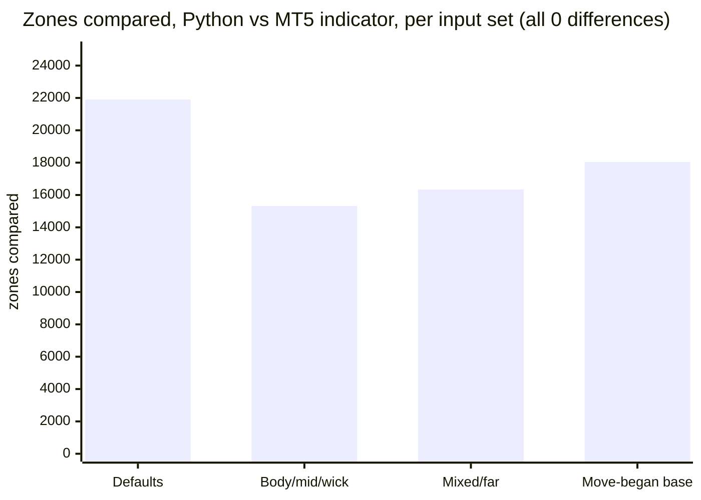

**2. Repaint probe.** An EA records which zone-event buffers are set on each bar *at the moment it closes*, then reads the
same bars again at the end and counts any value that changed. It also counts any event ever shown on the still-forming bar.

| Run | Closed bars checked | Zone events seen at close | Changed afterwards | Events on the live bar |
|---|---|---|---|---|
| MT5, EURUSD H1, every tick, 10,411,052 ticks | 4,644 | 531 | **0** | **0** |
| MT4, 49 runs combined | 1,005,828 | not summed | **0** | **0** |

Source: [`tests/results/repaint-summary.md`](tests/results/repaint-summary.md). The MT5 repaint probe was run once (EURUSD H1,
default inputs); the MT4 probe ran on every dump run.

**3. After the files were cut for this repository.** The code in this repository is the free indicator without anything
the free indicator does not call. After the cut, both editions were compiled again with MetaEditor (0 errors, 0 warnings;
test tools too), the reduced Python reference was compared with the full one on 647,820 bars of broker history over 32 runs
(EURUSD, XAUUSD, GBPJPY, BTCUSD x H1/H4 x the four input sets): every buffer and every zone state identical, and a reduced
MT5 parity run was repeated on the files in this repository: 8 dumps (defaults and the "where the move began" base, EURUSD and
XAUUSD, H1 and H4, 502,472 bars), all 13 buffers equal on every closed bar
([`tests/results/parity-after-cut.txt`](tests/results/parity-after-cut.txt)). The MT4 edition in this repository was
then run through the full MT4 matrix (EURUSD, GBPJPY, XAUUSD, BTCUSD x M15/H1/H4 x the four input sets, plus every tick
on EURUSD H1): 49 dumps, all identical to the reference on every closed bar, and the repaint probe found 0 closed bars
that changed afterwards. The large MT5 parity and repaint runs above were made on the build before the cut.

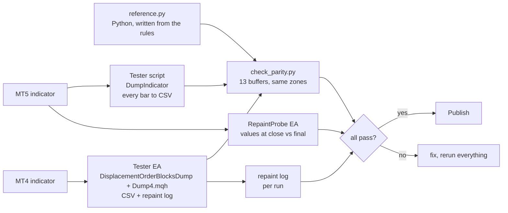

### Why the design cannot repaint

- The engine runs only over bars `0 .. rates_total - 2`, never the forming bar. The last buffer value is always empty.
- Each bar's result depends only on that bar and earlier bars. A zone that exists is never edited; it only changes state
  on later bars, and the drawing is rebuilt from the engine when a bar closes.
- A swing is known only `swing` bars after it formed, and it is used only from then on (no look-ahead).
- Alerts fire only for the bar that just closed, only after the history load, once per bar, and never in the tester.
- What *does* move: nothing on a closed bar. The right edge of live zones extends with the chart, which is a drawing
  detail, not a zone change.

## Architecture and buffers

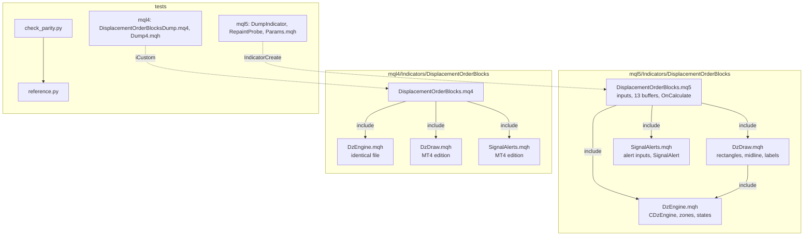

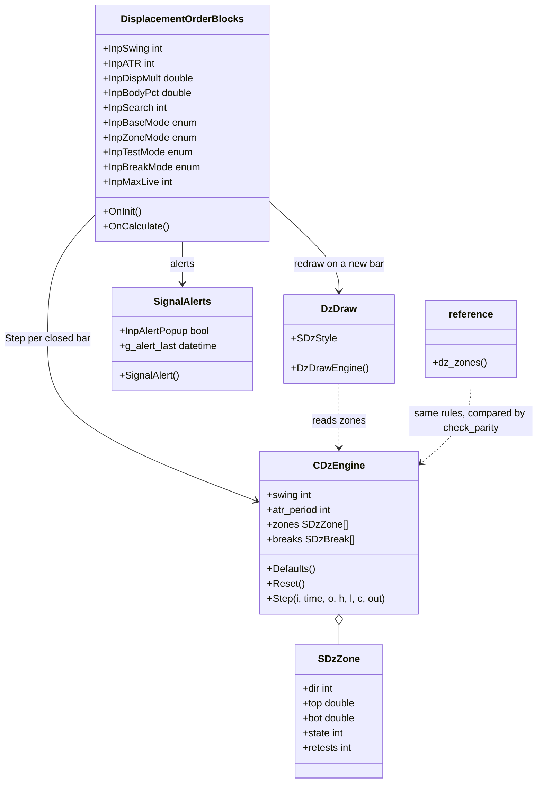

### `iCustom` buffer table (for EA developers)

All 13 buffers are the same in MT5 and MT4 and are not drawn (`DRAW_NONE`). A value is only set on the bar where the event
happened; otherwise `EMPTY_VALUE`.

| Buffer | Content |
|---|---|
| 0 / 1 | new demand zone: top / bottom |
| 2 / 3 | new supply zone: top / bottom |
| 4 | swing high that was closed through on this bar (price) |
| 5 | swing low that was closed through on this bar (price) |
| 6 | zones tested for the first time on this bar |
| 7 | retests of already tested zones on this bar |
| 8 | zones broken on this bar |
| 9 / 10 | live demand / supply zones after this bar |
| 11 / 12 | bars from the break bar back to the base candle of a new demand / supply zone |

Read events on **closed bars** (shift 1 and higher). `iCustom` parameters follow the input order below. In MT5 the
`input group` headings also count as string parameters when you build a handle with `IndicatorCreate` (see
`tests/mql5/Include/IndTest/Params.mqh`); MT4 has no groups.

## Inputs, alerts, install and compile

| Input | Default | Meaning |
|---|---|---|
| Swing strength, bars on each side | 3 | Bars each side that must be lower (higher) for a swing |
| ATR period | 14 | Wilder ATR length |
| Candle range at least, x ATR | 1.0 | Displacement candle range |
| Candle body at least, % of its range | 55 | Displacement candle body share |
| Bars searched back for the base candle | 12 | Search window before the break bar |
| Base candle | Nearest candle of the other colour | Or: other-colour candle where the move began |
| Zone covers | Whole base candle | Or: body only, or body plus the far-side wick |
| A zone is tested when | Price reaches the near edge | Or: the middle, or the far edge |
| A zone is broken when | A bar closes beyond the far edge | Or: a wick goes beyond the far edge |
| Live zones kept per side | 12 | 0 = no limit; the oldest of a side is dropped |
| Keep tested zones | true | Dashed outline |
| Keep broken zones | false | Grey, up to the bar that broke them |
| Middle line, labels, mark the swing | true, true, false | Display options |
| Draw zones made within this many bars | 1000 | Drawing range |
| Draw at most this many zones | 60 | Newest first |
| Extend live zones this many bars | 15 | Right edge past the last bar |
| Fill fresh zones, colours | true | Demand, supply and broken colours |
| Pop-up alert | true | Terminal alert window |
| Play a sound / sound file | false / alert.wav | File from the terminal's Sounds folder |
| Push notification | false | Needs your MetaQuotes ID in Options |
| E-mail | false | Needs e-mail set up in Options |
| Alert: new zone / fresh zone tested / zone broken | true / true / false | Which events alert |

**Install from source.** Copy `mql5/Indicators/DisplacementOrderBlocks/` into `<terminal data folder>/MQL5/Indicators/`
(MT5) or `mql4/Indicators/DisplacementOrderBlocks/` into `<data folder>/MQL4/Indicators/` (MT4), open
`DisplacementOrderBlocks.mq5` or `.mq4` in MetaEditor and press Compile (F7). Both compile with 0 errors and 0 warnings
(checked with MetaEditor on a Windows machine; the compiled files are not in the repository). Keep the files of each
edition together: the indicator includes `DzEngine.mqh`, `DzDraw.mqh` and `SignalAlerts.mqh` from its own folder.

## Run the Python reference and the tests

```bash
python3 -m venv .venv && . .venv/bin/activate && pip install -r requirements.txt
```

```python
import sys; sys.path.insert(0, "tests")
import numpy as np
from reference import dz_zones
# t, o, h, l, c are arrays of bar times and OHLC, oldest first; the last bar is the forming bar and is not used
buffers, zones, breaks, live, atr = dz_zones(t, o, h, l, c, swing=3, body_pct=55.0)
# buffers["dem_top"], ["dem_bot"], ... are the 13 buffers; zones[k]["state"] is 0 fresh, 1 tested, 2 broken, 3 dropped
```

To repeat the parity check on your own data:

1. Compile the indicator and the test tool for your platform (`tests/mql5/Scripts/DumpIndicator`, or
   `tests/mql4/DisplacementOrderBlocksDump.mq4` with `tests/mql4/Include/IndTest4/Dump4.mqh` in your
   `MQL4/Include/IndTest4/`; MT5 also needs `tests/mql5/Include/IndTest/Params.mqh`).
2. Run it for each symbol and timeframe, with the input sets in `tests/configs.tsv` (MT5) / `tests/mql4/configs.tsv` (MT4).
   The tool writes one CSV per symbol and timeframe with the 13 buffers (`b0` to `b12`).
3. `python3 tests/check_parity.py <folder with the CSVs>` (add `--mt4` for MT4 dumps). It prints PASS or FAIL per file and
   an overall result.
4. Repaint: run `tests/mql5/Experts/RepaintProbe` in the MT5 Strategy Tester (every tick); MT4 writes its repaint log with
   the dump.

The price dumps used for the published numbers are not in this repository (they are broker price data).

## Honest limits

- **Zones are descriptive, not predictive.** Against randomly placed levels the real zones did not react meaningfully
  better (see the study above). Use them to see where a strong move began, not as a forecast.
- **An indicator is not a strategy.** No stop-loss, position sizing or exit rules are provided or implied. No profit or
  accuracy claim is made. The only numbers here are about consistency (the implementations agree, nothing repaints),
  frequency (zones per month) and the random-placement study.
- **"Order block" is a convention, not a standard.** This is one precise definition. Other tools mark different candles
  and will show different zones.
- **Parameters were not optimised.** The defaults are round numbers, not fitted to results.
- **Data-dependent.** The ATR is seeded from the first bars in the terminal's history, and the swing search needs
  history, so the first zones of a short history can differ from a longer one.
- **Scope of the tests.** Four symbols, three timeframes, four input sets for parity; one MT5 repaint run. The random-placement
  study covers eight symbols on H1 and H4 on bid bars, without spread. Other symbols and timeframes are not covered by the
  published numbers. The MT5 build was not run on a live chart as part of these numbers.
- A multi-symbol scanner of these zones exists as a separate paid product (see below).

## Free vs Pro

| | Free: Displacement Order Blocks | Paid: Displacement Order Block Scanner |
|---|---|---|
| Platforms | MT5 and MT4, coming soon on the MQL5 Market | MT5 and MT4, coming soon on the MQL5 Market |
| Price | free | paid (see the Market page when it is live) |
| What you get | Zones, states, alerts on the current chart, source here | A multi-symbol, multi-timeframe scanner of the same zones, as described on its Market listing |
| Source | this repository | not published |
| Closed-bar zones, no repaint | yes | see its listing |
| Fresh / tested / broken, zone shapes, alerts | yes | see its listing |

No need to buy the paid product to use the free one: the free indicator is complete on its own.
Website: [allanninal.dev/mql5](https://www.allanninal.dev/mql5/#indicators) ([MT4](https://www.allanninal.dev/mql5/#mt4)).

## Licence

All files are © 2026 Allan Niñal under the [PolyForm Noncommercial License 1.0.0](LICENSES/PolyForm-Noncommercial-1.0.0.md)
(source-available, not OSI open source): free for personal and other noncommercial use, not for commercial use. Each source
file has an `SPDX-License-Identifier` line. The rules, the code and the tests were written for this project, and no
third-party code is included. The licence text is in [`LICENSE`](LICENSE). The licence applies to this source, not to
anything you build or trade with the indicator. Trading involves risk; the software is provided as is.

---

**Website:** [allanninal.dev/mql5](https://www.allanninal.dev/mql5/#indicators) · [MT4](https://www.allanninal.dev/mql5/#mt4) · [allanninal.dev](https://www.allanninal.dev)
· Questions: message me on [LinkedIn](https://www.linkedin.com/in/allanninal/).
